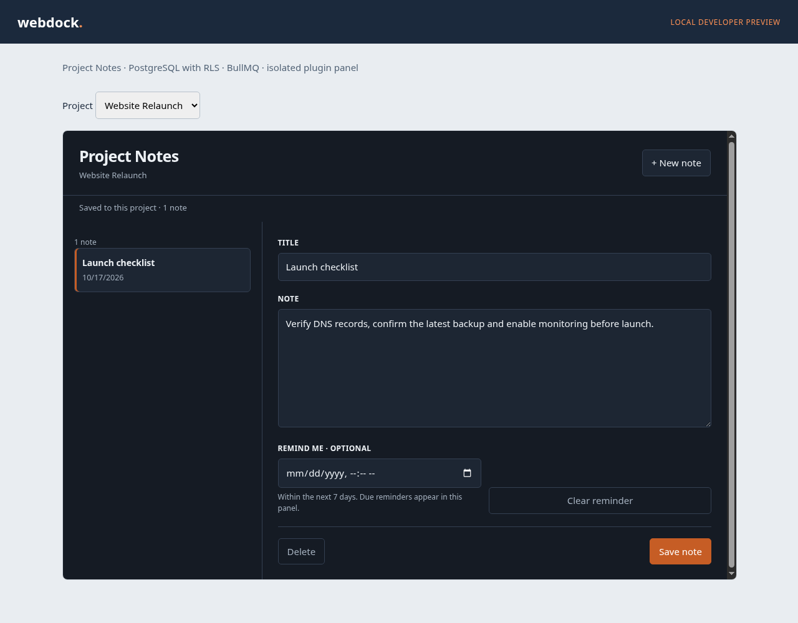
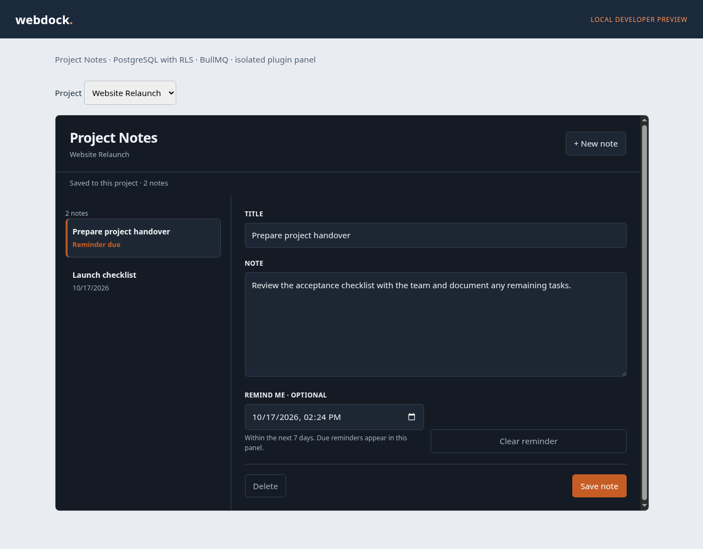

# Project Notes


Keep notes and reminders alongside the project they belong to.

## What you can do

Create, edit and delete notes; display due reminders; protect concurrent edits with revisions.

## Setup and access

An operator must install a compatible host integration with Core storage, jobs and project grants. Reminders are shown in the panel; no email or external notification is sent.

## Data and security

Core PostgreSQL row-level security scopes documents to their project. The runtime receives no database or Redis credentials. Deleting a note invalidates older reminder versions.

## Status and limits

Public developer alpha. Production installer, invocation and host UI integration remain release gates. Limits: 100 notes, 100-character title, 5,000-character text, 24 KiB per project document and reminders up to seven days ahead.

Catalog publication does not activate the plugin, enable public signup or grant
access to any customer resource. A new presentation release must use a new version;
previously signed releases and their assets stay immutable.

## Gallery context

The screenshots below show existing local authoring/test views with fictional
project data. They do not attest a live provider or customer deployment.

## Catalog source

`.tabularium` is the complete catalog-refresh source. It retains the immutable
runtime image and full protocol/access contract of the currently released
`0.1.0-alpha.2` and adds the prepared presentation assets. Refresh it only from a
reviewed immutable source commit. This does not replace signed release assets
or activate the runtime.

## Technical reference

The retained implementation notes below include platform integration procedures.
Commands referring to Core, `tools/` or `apps/console` require the [platform source
checkout](https://github.com/spitzli/webdock); they are not standalone setup steps.

Project-scoped notes and reminders for Webdock. Kind: `extension`.

- Create, edit and delete notes in a project overview panel.
- Optimistic revisions prevent overwriting someone else's edits.
- Reminders appear as **due** in the panel. No email or external notifications.
- Core PostgreSQL storage, RLS and BullMQ; no database or Redis credentials in the plugin.
- Pending reminders are retained in the note document. A declared 60-second reconciliation job repairs missed delivery, including exhausted retries.

## 0.1.0-alpha.2

Public developer preview. Notes, project isolation, optimistic editing, reminders and restart retention have been tested locally with actual PostgreSQL RLS, Core APIs and BullMQ.

**This alpha is not yet installable through the production Webdock Console.** The production installer, invocation transport and host UI integration remain release gates. This is an explicit prerelease, not a claim of production readiness.

## Screenshots

Real screenshots from the local authoring host:





## Build and test

The unreleased public SDK build is vendored as a tarball so this checkout builds without a private npm registry. Dependency versions and the base image are locked.

```sh
npm ci --ignore-scripts
npm run build
npm test
docker build -t project-notes:local .
```

The Webdock checkout supplies `tools/plugins/project-notes-host.ts`. It requires its explicitly created local PostgreSQL RLS fixture and a disposable Redis port:

```sh
WEBDOCK_TEST_REDIS_PORT=<local-port> node --import tsx tools/plugins/project-notes-host.ts /path/to/webdock-extension-project-notes --smoke
```

Without `--smoke`, it prints a loopback URL for browser testing. That host uses real restricted database roles and Core APIs with fixture identities, runs this plugin in a separate process, and embeds `/ui/notes` in a sandboxed iframe. It is not a substitute for the production installer.

## Runtime contract

Port 8080; `/healthz`, `/readyz`, `/webdock/actions`, `/webdock/jobs`, `/ui/notes`. The local runtime needs `WEBDOCK_PLUGIN_HOST_URL` and a 32+ character `WEBDOCK_PLUGIN_RUNTIME_TOKEN`. Bind defaults to loopback; the Dockerfile explicitly sets `HOST=0.0.0.0` inside a container. The host supplies an invocation token per backend call. No host token enters the frame.

Actions: `notes.list`, `notes.save`, `notes.delete`.
Jobs: `notes.remind`, `notes.reconcile`.

Limits: 100 notes, title 100 characters, text 5000 characters, total project document 24 KiB, reminders at most seven days ahead. The smaller document cap keeps action/frame responses below 32 KiB. Save/delete require the document revision and an idempotency request ID. Editing or deleting a note invalidates old reminder versions.

The release includes an immutable OCI image reference and an identical universal JSON descriptor. Publishing this developer preview does not activate a plugin in a Webdock project.

## Blacksmith CI

The Blacksmith GitHub App is installed for the exact 16 Spitzli platform, plugin and SDK repositories. The configured and observed region is `us-west`, under the owner’s EU-only exception for Spitzli’s own GitHub CI. The official managed-builder probe passed with `nofallback: true`. These prepared workflows use only Blacksmith; actual per-repository source checks and publication of the regular workflows remain pending. Provider and customer credentials are not used for source checks, and no builder fallback is allowed.

The prepared manual `Plugin Blacksmith build` workflow can push a checked image candidate by enabling `publish_image`. It records the immutable image/source identity; existing versioned registry manifests and releases are unchanged. A new registry version still requires its proper manifest and signed integrity verification.
