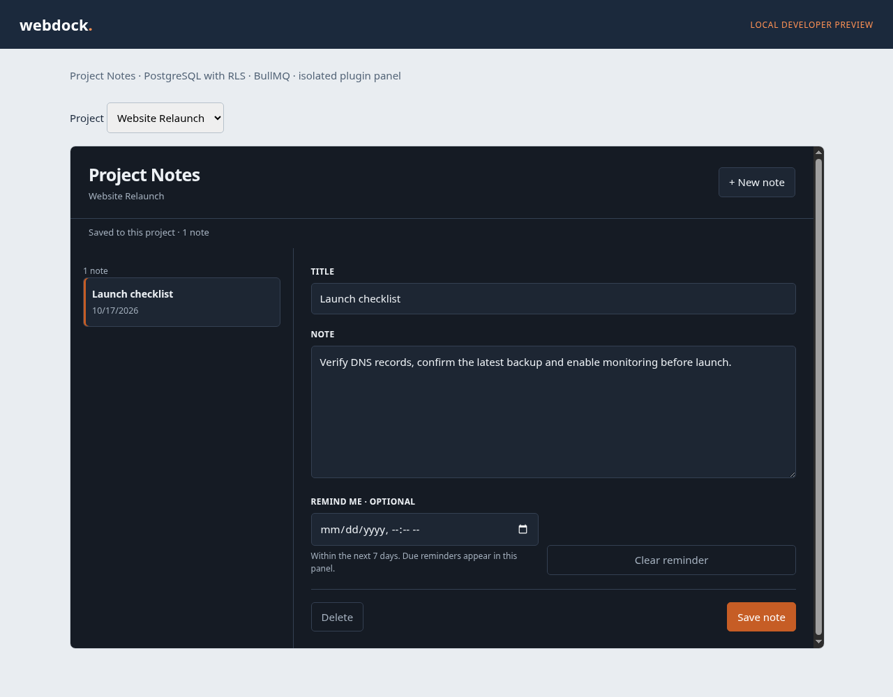
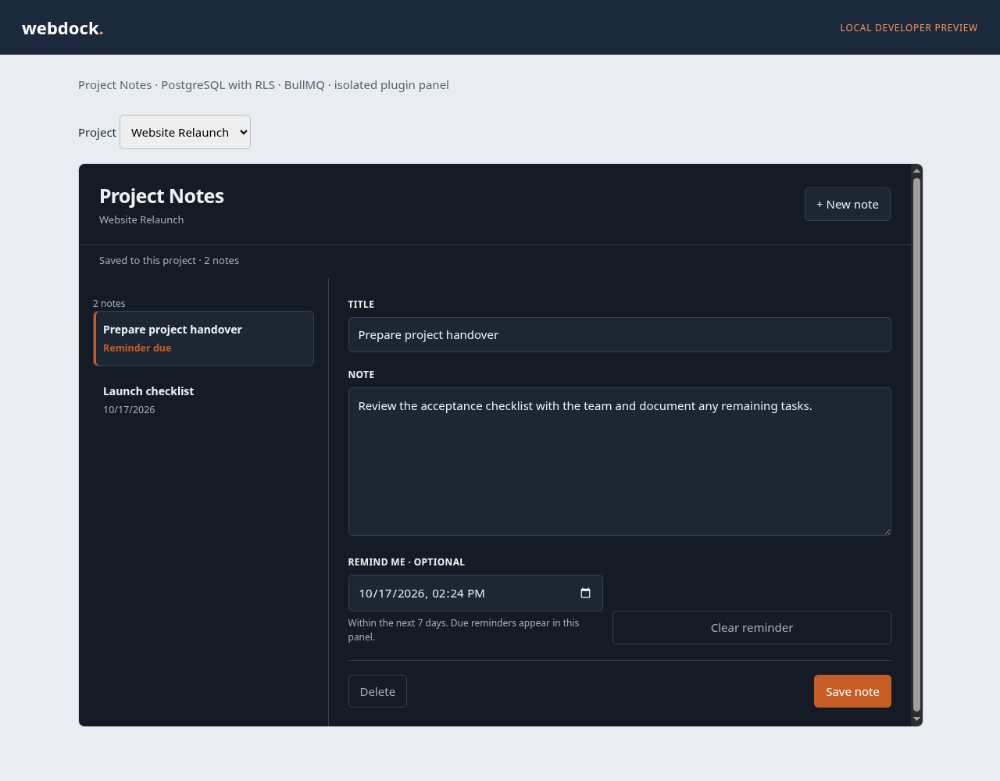

# Project Notes

Project-scoped notes and reminders for Webdock. Kind: `extension`.

- Create, edit and delete notes in a project overview panel.
- Optimistic revisions prevent overwriting someone else's edits.
- Reminders appear as **due** in the panel. No email or external notifications.
- Core PostgreSQL storage, RLS and BullMQ; no database or Redis credentials in the plugin.
- Pending reminders are retained in the note document. A declared 60-second reconciliation job repairs missed delivery, including exhausted retries.

## 0.1.0-alpha.1

Public developer preview. Notes, project isolation, optimistic editing, reminders and restart retention have been tested locally with actual PostgreSQL RLS, Core APIs and BullMQ.

**This alpha is not yet installable through the production Webdock Console.** The production installer, invocation transport and host UI integration remain release gates. This is an explicit prerelease, not a claim of production readiness.

## Screenshots

Real screenshots from the local authoring host:





## Build and test

The unreleased public SDK build is vendored as a tarball so this checkout builds without a private npm registry. Dependency versions and the base image are locked.

```sh
npm ci --ignore-scripts
npm run build
npm test
docker build -t project-notes:local .
```

The Webdock checkout supplies `tools/plugins/project-notes-host.ts`. It requires its explicitly created local PostgreSQL RLS fixture and a disposable Redis port:

```sh
WEBDOCK_TEST_REDIS_PORT=<local-port> node --import tsx tools/plugins/project-notes-host.ts /path/to/webdock-extension-project-notes --smoke
```

Without `--smoke`, it prints a loopback URL for browser testing. That host uses real restricted database roles and Core APIs with fixture identities, runs this plugin in a separate process, and embeds `/ui/notes` in a sandboxed iframe. It is not a substitute for the production installer.

## Runtime contract

Port 8080; `/healthz`, `/readyz`, `/webdock/actions`, `/webdock/jobs`, `/ui/notes`. The local runtime needs `WEBDOCK_PLUGIN_HOST_URL` and a 32+ character `WEBDOCK_PLUGIN_RUNTIME_TOKEN`. Bind defaults to loopback; the Dockerfile explicitly sets `HOST=0.0.0.0` inside a container. The host supplies an invocation token per backend call. No host token enters the frame.

Actions: `notes.list`, `notes.save`, `notes.delete`.
Jobs: `notes.remind`, `notes.reconcile`.

Limits: 100 notes, title 100 characters, text 5000 characters, total project document 24 KiB, reminders at most seven days ahead. The smaller document cap keeps action/frame responses below 32 KiB. Save/delete require the document revision and an idempotency request ID. Editing or deleting a note invalidates old reminder versions.

The release includes an immutable OCI image reference and an identical universal JSON descriptor. Publishing this developer preview does not activate a plugin in a Webdock project.
